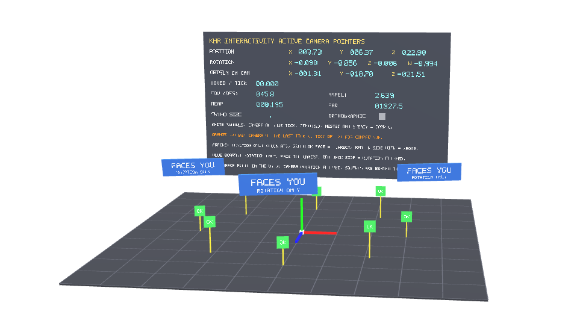

# Active Camera

## Screenshot

## Description

Visualizes the read-only activeCamera pointers. A crosshair and squares are placed in front of the camera every tick and must stay centered and steady while the camera moves; an orange square shows the camera of the previous tick for comparison. Billboards use only the camera rotation, arrows only the camera position. A panel shows position, rotation, the origin in camera space and the projection values.

## License Information

Donated by Needle for glTF testing.

This model is licensed under a Creative Commons Attribution 4.0 International License.
