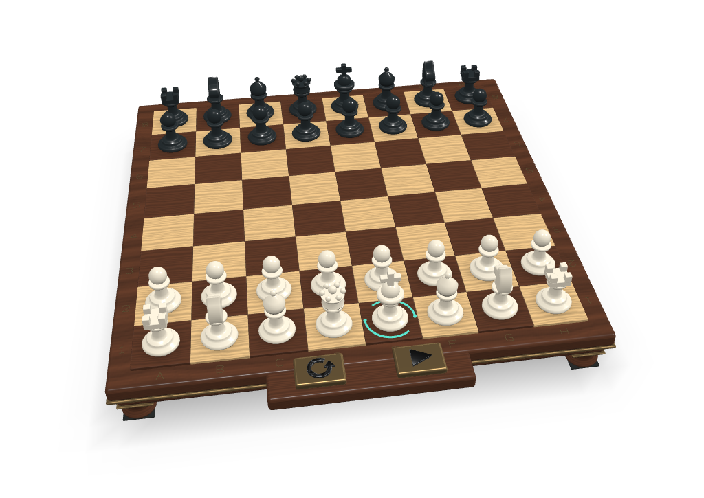

# Mini Chess

## Screenshot

## Description

A complete chess game with a built-in computer opponent, running entirely in KHR_interactivity. It has two play modes:

- **Human vs Computer**: Click one of your pieces (White), then click the target square. The computer answers with Black.
- **Computer vs Computer**: Click the play button on the front rail and the computer plays both sides automatically. Click it again (pause) to stop and take over.

The reset button (circular arrow) starts a new game. The glowing halo around a king shows whose turn it is. Pieces lift on hover, move along an arc and captured pieces are placed beside the board. Castling and pawn promotion are supported.

The chess engine is [Toledo Nanochess](https://github.com/azer/toledo-chess) by Oscar Toledo G. Its JavaScript source was compiled into KHR_interactivity graphs. The move search is spread over several frames (a fixed step budget per tick), so the scene keeps rendering while the computer is thinking.

The graph also sends custom events, which an app can listen to: `mini-chess:move`, `mini-chess:turn`, `mini-chess:reset-complete` and `mini-chess:self-play`.

## License Information

Donated by Needle for glTF testing.

Chess engine: Toledo Nanochess, Copyright (c) Oscar Toledo G.

This model is licensed under a Creative Commons Attribution 4.0 International License.
